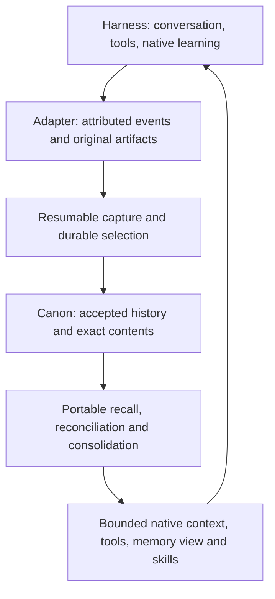

# Portable being memory across agent harnesses

Research date: 2026-10-12. Status: source-grounded architectural recommendation;
new receiving integrations are not implemented or qualified by this report.
Continuation: [HMK #11](https://github.com/nicoechaniz/hermes-memory-kit/issues/11),
[Codex plan](../../docs/codex-hmk-provider-plan.md),
[durable recall roadmap](../../docs/durable-recall-plan.md).

## Decision supported by the investigation

Make the portable being-memory system the default for compatible embodiments.
HMK is its initial storage, retrieval and consolidation implementation. Integrate
through each harness's supported facilities; use native memory components when
they implement a useful, accountable part of the same lifecycle. A second,
independently maintained autobiography should not be the default.

This refines the earlier recommendation to keep both Codex native memory and HMK.
There should be one continuity contract, with different implementations of its
functions. Native startup context, memory tools or learning can participate
without native storage becoming the sole surviving record of the being.
Conversely, a portable adapter need not reproduce a mature native mechanism
merely because it was not written in HMK.

Offer a projection-only mode for people who choose their harness's own memory.
Describe its actual coverage and return-path limitations. Do not assert that all
native systems perform worse: this investigation measured no comparative recall,
latency or cost. Reduced preservation guarantees and inferior answer quality are
different claims. A native implementation that satisfies the full contract can
be a fully compatible backend, rather than permanently second-class.

## Method and evidence boundaries

One coordinator inspected official documentation and selected public source;
no new receiver or model benchmark ran. The sample spans explicit memory-provider
interfaces, extensible local agents, file-based native memory, persistent agent
filesystems, IDE products and hosted assistants. These are thirteen product/runtime
cases, not thirteen statistically independent systems. OpenClaw and Pi, for example,
have architectural connections; a cloud product and its delegated Codex task
must not be counted as the same memory boundary.

The previous [persistent Codex qualification](pilots/2026-10-11-persistent-codex-coordinator.md)
is reused as execution evidence. All other proposed HMK adapters below remain
designs inferred from documentation or code. No private corpus, credential, hosted
account, autonomous process or production setting was accessed or changed.

Public repository snapshots inspected:

| Repository | Source commit | Release observed separately |
|---|---|---|
| OpenClaw | `2f034e8b5a7995f4b1fa1c7e977e09a6841b5920` | `v2026.10.1` |
| Pi, now `earendil-works/pi` | `4270522473e677ddba7b093caa0064a3df51d459` | `v1.1.0` |
| Goose, now `aaif-goose/goose` | `4617040c7b650b37d599bdaa08d3790572c19ae8` | `v1.54.0` |
| Existing Hermes fork | `8a13834d6e7e2792ce4b5d8bf17568c8a467acdb` | Local source inspection; not a deployment claim |
| Qualified Codex fork | `ddb7f3e0ed62baa0e0447cb8da1aa377860b33e4` | `0.160.0-hmk.1`, previous receiving evidence |

Main-branch APIs are not necessarily in those releases. Pin and verify the
receiving build before implementation. Official web documentation was accessed
on the research date; its page date is not necessarily the feature release date.
The companion [source manifest](2026-10-12-harness-sources.json) records downloaded
public source hashes. A guessed Pi `session.md` path returned 404; discovery found
the actual `sessions.md`, which was read. Missing documentation is reported as an
unestablished capability, not proof that no implementation exists.

## Harness comparison

| Harness / product | Established integration surface | Recommended first HMK route | Principal unresolved boundary |
|---|---|---|---|
| Hermes | External `MemoryProvider`, recall, turn sync, native-write mirror | Provider using existing HMK services | Built-in memory remains additive; complete tool evidence and native edits need explicit ownership |
| OpenClaw | Exclusive memory capability, neutral provider runtime, provider flush | Native provider plugin | Search slot does not own every writer or the separate dreaming sidecar |
| Pi | In-process extensions, context transforms, tools and session events | Extension plus local core | Capture all significant tool results, branches and compaction boundaries |
| Goose | Memory is a replaceable MCP extension; plugin hooks | HMK MCP extension and bounded context | Lifecycle hooks alone are not durable capture; preload and results coverage need verification |
| OpenCode | Plugins, message/tool/session events and compaction customization | Plugin plus HMK tools | Some context interfaces are experimental; compaction is not durable memory |
| Claude Code | Auto-memory files, instructions, MCP and lifecycle/file hooks | Plugin with common recall/capture; optional managed native view | Arbitrary file edits and per-project/subagent scopes must round-trip |
| Gemini CLI | Memory files, synchronous hooks, candidate inbox and skills | Extension with common recall/capture | Direct writes and experimental background candidates are separate paths |
| Cursor | Rules, MCP and hooks; cloud automation memory separately | Local plugin; separate cloud qualification | Fire-and-forget lifecycle and memory outside working filesystem |
| Grok Build | Rules, MCP, lifecycle hooks and saved sessions | MCP/tools plus supported context integration | Passive hook stdout is ignored; do not copy Claude injection assumptions |
| Grok Bot | Persistent hosted notes, files, profiles and learned skills | Selected external memory access / projection, initially limited | Complete native-note export and change stream not established |
| OpenAI dots | ChatGPT context plus separate dot notes, plugins and computers | Selected external memory access / projection, initially limited | Dot notes and delegated task state are distinct; full return path not established |
| Letta Code | Git-backed MemFS, mods, memory/history management | Accountable MemFS bridge plus common deep recall | Local uncommitted changes, push, dreaming and host-specific mod coverage |
| Codex | Native projection/formation and qualified explicit capture cycle | Reuse projection; qualify common recall/capture against native formation | Complete provider replacement and unattended lossless native intake remain unqualified |

### Explicit provider hosts: Hermes and OpenClaw

Hermes already models memory as a provider. Its lifecycle includes prefetch,
turn synchronization, session transitions and mirroring built-in memory writes.
The built-in files remain active alongside an external provider. Therefore
selecting HMK alone does not eliminate duplicate writers. Its developer contract
also exposes pre-compression checkpoint support; the local inspected code
distinguishes best-effort legacy behavior from opt-in checkpoint version 2.
Reuse that boundary instead of constructing a second session watcher.
[Provider documentation](https://hermes-agent.nousresearch.com/docs/user-guide/features/memory-providers),
[inspected provider API](https://github.com/nicoechaniz/hermes-agent/blob/8a13834d6e7e2792ce4b5d8bf17568c8a467acdb/agent/memory_provider.py),
[manager](https://github.com/nicoechaniz/hermes-agent/blob/8a13834d6e7e2792ce4b5d8bf17568c8a467acdb/agent/memory_manager.py).

OpenClaw is the strongest direct-provider design precedent in this sample. Its
inspected SDK supports `registerMemoryCapability`, provider-scoped references,
revision-aware retrieval, capability declarations and caller-bound authority.
Search, get, health and optional candidates/refresh are distinct operations.
It also supports provider-owned pre-compaction persistence tools. These are real
source interfaces, not a claim that an HMK implementation already works there.
[SDK contract](https://github.com/openclaw/openclaw/blob/2f034e8b5a7995f4b1fa1c7e977e09a6841b5920/docs/plugins/sdk-overview/memory-and-context.md),
[types](https://github.com/openclaw/openclaw/blob/2f034e8b5a7995f4b1fa1c7e977e09a6841b5920/src/plugins/memory-provider-types.ts).

Important integration traps: selecting another provider can still activate Memory
Core for dreaming; explicitly disabling it prevents that sidecar. The neutral
read runtime does not absorb startup files, every mutation, reset or maintenance.
Automatic recall requires declared capabilities and tool access; search alone is
insufficient. Flush completion can be a successful persistence tool or a silent
no-op, so a host completion signal is not itself proof of a canonical write.
[Same SDK lifecycle contract](https://github.com/openclaw/openclaw/blob/2f034e8b5a7995f4b1fa1c7e977e09a6841b5920/docs/plugins/sdk-overview/memory-and-context.md).

OpenClaw's tracked consolidation transfers source origins through merges and
supersession; repeated claims are not extra corroboration. It documents gaps for
untracked direct edits and legacy records. This is useful behavior to reuse or
learn from, and a counterexample to treating native memory as universally naive.
[Provenance implementation contract](https://github.com/openclaw/openclaw/blob/2f034e8b5a7995f4b1fa1c7e977e09a6841b5920/docs/concepts/memory-provenance.md).

Its cross-assistant importer copies selected Markdown from Codex, Claude Code
and Hermes into separate indexed imports. That does not import complete sessions,
skills, revision history, Matrix admission or a being-level authority model.
Interoperable files are useful transport, but not our complete preservation profile.
[Memory/import documentation](https://docs.openclaw.ai/concepts/memory).

### Extensible local runtimes: Pi, Goose and OpenCode

Pi exposes tools, MCP registration, context transformations and message/tool
events. `agent_end` is not necessarily final: retries and queued work can follow;
`agent_settled` is the final notification. Session entries preserve branches and
compaction history. Nested tool calls have observable execution events, while
their results are not independently persisted as transcript entries. A capture
adapter that only reads the final assistant message can miss meaningful actions.
[Extension guide](https://github.com/earendil-works/pi/blob/4270522473e677ddba7b093caa0064a3df51d459/packages/coding-agent/docs/extensions.md),
[sessions](https://github.com/earendil-works/pi/blob/4270522473e677ddba7b093caa0064a3df51d459/packages/coding-agent/docs/sessions.md).
The inspected default session machinery is not a complete autobiographical
selection policy. An extension is the natural place to supply ours.

Goose's built-in memory extension stores categorized local/global files and offers
remember, retrieve and remove tools. Source inspection confirms global memories
are incorporated into server instructions; the documentation describes broader
session preload. Do not project an unbounded lifelong corpus there. An HMK MCP
extension can serve bounded recall and writes, with a small native orientation.
[Memory guide](https://github.com/aaif-goose/goose/blob/4617040c7b650b37d599bdaa08d3790572c19ae8/documentation/docs/mcp/memory-mcp.md),
[implementation](https://github.com/aaif-goose/goose/blob/4617040c7b650b37d599bdaa08d3790572c19ae8/crates/goose-mcp/src/memory/mod.rs).
Goose hooks distinguish successful, failed and denied tool calls, but documented
payloads do not establish complete tool-result capture. Some delivery is explicitly
best-effort. Hook-name compatibility is insufficient evidence of durable delivery.
[Hook contract](https://github.com/aaif-goose/goose/blob/4617040c7b650b37d599bdaa08d3790572c19ae8/documentation/docs/guides/context-engineering/hooks.md).

OpenCode plugins receive message, tool and session events and can define tools.
They can augment or replace the experimental compaction prompt. These support a
portable adapter; they do not by themselves establish lifelong memory, an atomic
write checkpoint, or a compatible native-memory export. Keep session summaries
separate from selected durable records. Pin the plugin API used by the adapter.
[Official plugin contract](https://docs.opencode.ai/docs/plugins/).

### Native files with plugins: Claude Code and Gemini CLI

Claude Code separates persistent instructions from automatically written memory.
Auto memory is normally repository-scoped, can use a configured directory, and
loads a bounded `MEMORY.md` index with other files read on demand. Subagent memory
has separate scope. This is a useful projection surface, not automatic being-wide
identity or retrieval. Disabling auto memory is supported.
[Memory](https://code.claude.com/docs/en/memory).
Lifecycle hooks include context contribution, tool outcomes, compaction and file
changes. A plugin can combine common recall/capture with native files. Still
qualify shell edits, asynchronous writers and interruption; file notification is
not a transaction receipt. Project memory paths must not collapse unrelated beings.
[Hooks](https://code.claude.com/docs/en/hooks).

Gemini CLI now documents direct Markdown edits for remembered facts rather than
requiring a special memory tool. Its experimental Auto Memory creates patch and
skill candidates in a review inbox, with session eligibility restrictions and
explicit application. Capture both direct edits and applied candidates; retain
the distinction between proposed and accepted learning.
[Memory files](https://geminicli.com/docs/tools/memory/),
[Auto Memory](https://geminicli.com/docs/cli/auto-memory/).
Its hooks can add per-turn context and observe model/tool/agent boundaries.
An `AfterAgent` rejection requests another model turn: persistence retries should
not accidentally become repeated narrative-review loops.
[Hook reference](https://geminicli.com/docs/hooks/reference/).

### IDE and hosted boundaries: Cursor, Grok and dots

Cursor rules and hooks provide local integration paths. Its documented
`sessionStart`/`sessionEnd` hooks are fire-and-forget; pre-compaction observation
does not block compaction. A durable adapter therefore cannot rely only on a final
hook firing successfully. Cloud Automations have separately managed memory outside
the agent working filesystem, so a repository/filesystem backup is incomplete.
[Rules](https://cursor.com/docs/rules), [hooks](https://cursor.com/docs/hooks),
[automation memory](https://cursor.com/docs/cloud-agent/automations).
Historical Cursor Memories documentation is not taken as proof of the current
export or lifecycle contract across IDE, CLI and cloud products.

Grok Build documents MCP, rule files, local saved sessions and lifecycle hooks.
However, passive hook stdout is ignored; a Claude-style `SessionStart` response
must not be assumed to inject memory. Use documented rules/tools initially and
diagnose the supported dynamic context path before promising spontaneous recall.
Session history and compaction do not establish cross-session durable selection.
[Hooks](https://docs.x.ai/build/features/hooks),
[rules](https://docs.x.ai/build/features/project-rules),
[sessions](https://docs.x.ai/build/features/sessions),
[MCP](https://docs.x.ai/build/features/mcp-servers).

Grok Bot is a different hosted product. Bots retain individual learned context
but share an account computer and files. Its Duplicate operation copies settings
and skills but explicitly excludes learned memory and conversation history.
Skills are shared across the account's Bots. Neither duplicate nor copying the
computer constitutes complete portable-being export.
[Overview](https://docs.x.ai/grok-bot/overview),
[duplicate semantics](https://docs.x.ai/grok-bot/bots),
[skills](https://docs.x.ai/grok-bot/skills-routines-and-automations).
A complete native-memory read/change/export contract was not established from
these official pages. Treat external-memory access as a limited integration until
an actual account diagnostic establishes the missing surface.

OpenAI dots uses relevant ChatGPT memory and its own separate notes. Delegated
tasks receive selected context, not the dot's entire history; changing ChatGPT
memory settings need not change existing dot notes. Plugins and connected
computers are possible access routes, not documented replacement of dot memory.
[Tasks and memory](https://learn.chatgpt.com/docs/dots/tasks-and-memory),
[computers and apps](https://learn.chatgpt.com/docs/dots/computers-and-apps).
No complete native-note export/change stream was established in the inspected
official documentation and targeted documentation searches. A dot launching our
Codex adapter does not prove that the dot itself has the same continuity contract.

### A serious native bridge candidate: Letta Code

Letta's current MemFS is a Git-backed memory repository, materialized as an editable
checkout. Root files supply standing context; indexed subdirectories hold details
for on-demand reading. Local edits must be committed and pushed to propagate.
Semantic search is an optional mod rather than an intrinsic default of MemFS.
[MemFS](https://docs.letta.com/concepts/memfs).
Dreaming reviews recent conversations and changes memory. App Server exposes
memory files, history and commit diffs; mods provide local integration, with
different event availability in desktop listeners.
[Dreaming](https://docs.letta.com/configuration/memory),
[protocol](https://docs.letta.com/self-hosting/app-server/protocol-lifecycle),
[mods](https://docs.letta.com/configuration/mods).
This merits a future accountable native bridge, preserving Git history and pending
working-tree changes. It does not justify forcing a Letta service into every other
harness. Re-evaluate current Code/App Server, not retired V1 memory-block or
AgentFile assumptions.

### Codex: retain the qualified work, change what it proves

The completed fictional cycle demonstrates native use, new learning, canonical
incorporation, correction, reconstruction and safe rollback. Its coordinator is
explicit and requires stopped native writers. It does not prove unattended
capture, semantic novelty detection or complete native-provider replacement.
[Receiving evidence](pilots/2026-10-11-persistent-codex-coordinator.md),
[coordinator contract](../../docs/codex-coordinator.md).

Keep this bridge. Compare it with common-layer capture and recall only where a
specific behavioral or operational difference matters. Native formation is an
optional candidate producer whose value must justify its additional state and
capture obligations. Native context management and session continuity remain
harness responsibilities regardless of the selected durable memory mechanism.

## The portable contract and the exact hybrid division

The following is a proposed contract decomposition, not a new implemented API or
a change to Matrix's closed schemas.

| Responsibility | Owner | Native component's permitted role |
|---|---|---|
| Being identity and accepted memory authority | Existing Matrix admission and signed runtime | Consume an authorized projection; never mint authority from a path/account/model claim |
| Durable content, revisions, evidence and retained artifacts | Canonical preservation, initially HMK plus referenced content | Provide original learning artifacts; keep unavailable native extensions opaque rather than flattening them away |
| Context budget and ongoing session continuity | Harness | Manage compaction, resumption and working context |
| Durable selection | Common being-memory policy | Propose lessons; use qualified native extraction for assigned sources, with coverage checked |
| Recall and current applicability | Common services, or a qualified delegated implementation | Inject a bounded view and search deeper; native miss does not imply canonical absence |
| Native working memory | Adapter-managed view and pending native learning | Read/write locally under an explicit capture contract |
| Consolidation | One designated owner for each corpus/transformation | Reuse a native consolidator only with preserved inputs, outputs and mapped corrections |
| Refresh and return path | Resumable adapter/coordinator | Preserve new work before replacing views; never push stale views over later learning |
| Cross-being sharing | Authorized Matrix/source routes | Receive attributed material; shared storage or a conversation does not merge identities |

The graph is logical, not a requirement to host a server. Use files, SQLite and
existing local APIs; add local stdio MCP or an in-process bridge where useful.
Cloud access can be optional and narrowly exposed. Do not require a vector
service or remote memory API merely to embody the being.

A minimal common interface needs bounded recall, exact revision resolution,
attributed event/artifact intake, capture receipts/cursors, projection preparation
and verification, correction/invalidation, and preservation/reconstruction.
Adapters also need capability and health reporting. Reuse HMK's existing
`hybrid-pack`, support-currency, capture ledger, learning-bundle and projection
operations before inventing new storage or protocols. MCP conveys tools; shared
Markdown/skill formats convey some artifacts. Neither supplies the complete
authority, correction or bidirectional lifecycle contract.

### Avoiding lost learning and false autobiography

1. Capture significant observations while available, including tool failures,
   communications, human reports and native memory/skill changes. Record actual
   outcomes and source event IDs. Native selection alone may miss a meaningful
   encounter that provides no coding productivity lesson.
2. Use a private, bounded pending journal until a selection/checkpoint decision
   succeeds. Keep enough source evidence to stand without original sessions.
   A capture journal is not permission to retain every transcript or secret as
   lifelong memory; eligibility, retention and audience still apply.
3. Preserve exact native learning and available history before refresh, pruning,
   reset or migration. Preserve dirty files as well as commits. If the host cannot
   delay destruction and no earlier checkpoint exists, expose a capture gap.
4. Distinguish inherited projections, newly observed events, reported experiences
   and new interpretations. Rephrasing old memory is not another encounter or
   independent evidence. Hash equality detects exact replay, not semantic truth.
5. Reconcile corrections against source revisions and dependent accounts before
   republishing. A local cache deletion is not automatically a canonical retraction.
   Invalidate live context too, or start a fresh receiving session when the host
   cannot refresh it safely; changing files alone does not remove stale context.
6. Acknowledge the source checkpoint only after the required durable receipt.
   Crash/retry reuses event identities. Same-being concurrent bodies retain distinct
   source streams and conflicts; different beings never share a private namespace
   merely because they use the same machine or provider account.

Matrix-accepted lanes and HMK-native originals keep their existing authority
during transition. A ledger hash needs its exact payload; export does not admit
memory. Preserve peer-origin records as peer-attributed, and distinguish a shared
event from each being's own uptake. Inheritance transfers selected principles,
not another being's autobiography or private permissions.
[Matrix memory boundary](https://github.com/AlterMundi/daimon-matrix/blob/614783b/specs/memory-boundaries.md),
[preservation](https://github.com/AlterMundi/daimon-matrix/blob/614783b/docs/runbooks/memory-preservation.md).

## Choosing the default without imposing duplicate work

Offer three explicit integration profiles:

- **Portable memory:** our lifecycle owns durable selection/recall/consolidation;
  native instructions, tools and context carry it. Native independent durable
  formation is disabled or has a narrow, captured role. This is the recommended
  default where the adapter supports it.
- **Qualified hybrid:** selected native functions are part of that lifecycle,
  with source ownership, original-artifact capture, one consolidation owner and
  reconstruction tests. Enable a native learner only when its measured benefit
  warrants its additional work and failure modes.
- **Native projection:** export a usable subset and preserve the neutral canon.
  Report what is accessible, preserved but dormant, pending capture, unsupported
  or unavailable. If return capture is missing, new experience may remain trapped;
  never market that mode as full portable continuity.

Existing native memories must be preserved and reconciled before switching modes.
A rollback restores configuration without overwriting memories learned afterward.
No profile automatically shares another being's data or enables autonomous
attention. This proposal does not activate hooks, native generation or timers.

Efficiency should come from incremental local capture, stable IDs, cached bounded
recall, and batching selected deltas for consolidation. There should not be a
second full transcript extraction by HMK after native extraction unless it answers
a measured coverage gap. A cheap local event checkpoint need not call an LLM.
Keep source capture and daily synthesis separate: waiting until a daily job to
save the only copy of an important event risks losing it first.

## Bounded next delivery and stopping conditions

Do not implement thirteen adapters or rerun the old consolidation batteries.

1. Extract the reusable contract from existing HMK capture/projection services and
   qualify a second integration shape: **OpenClaw's explicit provider slot** is
   the best new diagnostic candidate. First verify the required API in an actual
   installable version; otherwise use **Pi's extension** to avoid an upstream
   feature wait. Hermes remains the existing practical portability anchor.
2. Reuse the fictional corpus for **Codex → canon → Hermes → canon → Codex**,
   covering native new learning, a deep record absent from the initial summary,
   a non-procedural encounter, a correction and a capability-scoped learned skill.
   Qualify cross-harness behavior without source sessions; do not repeat valid
   preservation or consolidation work merely to rename an adapter.
3. For one new adapter, test ordinary unprompted memory use, a failed tool result,
   interruption before capture acknowledgement, replay, correction of loaded
   context, expiry, and safe rollback. Verify a separate being cannot retrieve or
   overwrite the first being's private memory. Keep rubrics outside receivers.
4. Compare portable-only versus hybrid on identical selected cases and model
   conditions where possible. Record each runtime/model difference. Choose hybrid
   only if it adds useful learning or behavior at acceptable total cost; otherwise
   prefer the simpler single-lifecycle route.

Report selection coverage, conversational fidelity, useful action, preservation,
capture gaps, context size, calls, latency, storage and known/unknown cost
separately. Source/documentation inspection cannot award a receiving pass.
The hybrid must demonstrate complete return capture for the tested native paths,
not merely successful import. A closed hosted surface without that evidence stays
limited; it does not block improving local adapters.

The next implementation task should start at the versioned adapter contract and
the OpenClaw/Pi seam diagnostic, reusing the existing Codex coordinator and Hermes
binding. This research establishes a direction and concrete gaps, not universal
compatibility, native inferiority or authorization for production automation.
